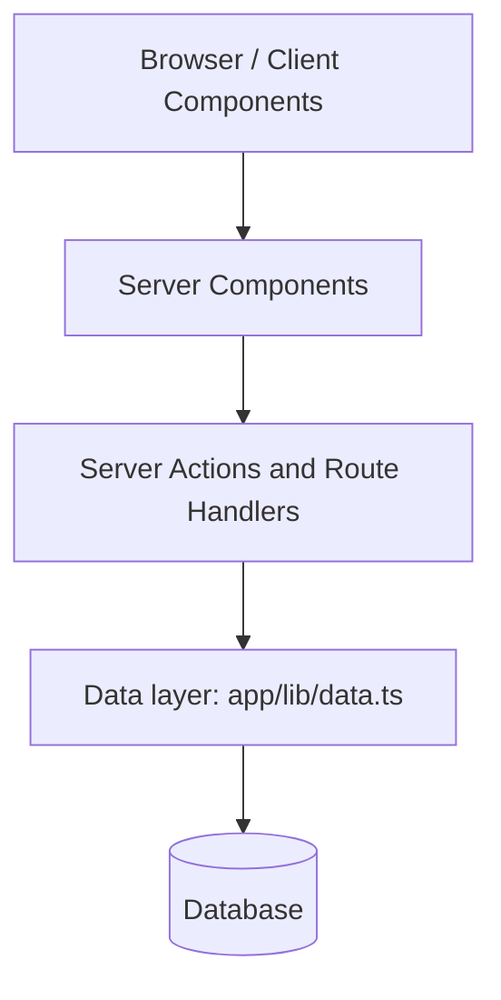

# Architecture

## Layer diagram

## Layers

### 1. Browser / Client Components
Runs in the user's browser. Handles things that need interactivity, such as the search box, pagination buttons and form inputs (files marked `'use client'`). It never talks to the database directly.

### 2. Server Components
Runs on the server when a page is requested. Pages like `app/dashboard/page.tsx` fetch data by calling the data layer and send finished HTML to the browser. Secrets and database access stay on the server.

### 3. Server Actions and Route Handlers
Handle writes and requests from the browser: creating, updating and deleting invoices (`app/lib/actions.ts`) and auth callbacks (`app/auth/callback/route.ts`). They validate input (e.g. with Zod), call the data layer, then revalidate the page cache.

### 4. Data layer (`app/lib/data.ts`)
The only place that contains SQL queries. It returns typed data to the layers above, so pages never write SQL themselves. If the database changes, only this file needs to change.

### 5. Database
Stores users, customers, invoices and revenue (Neon Postgres). It is responsible for persistent storage and data integrity.

## Where does new code go? (example: invoice status filter)

| Need | Layer | File |
|---|---|---|
| Filter dropdown UI | Client component | `app/ui/invoices/status-filter.tsx` |
| Page reads the filter from the URL and shows results | Server component | `app/dashboard/invoices/page.tsx` |
| SQL query with the status condition | Data layer | `app/lib/data.ts` |
| Changing a status (write) | Server Action | `app/lib/actions.ts` |